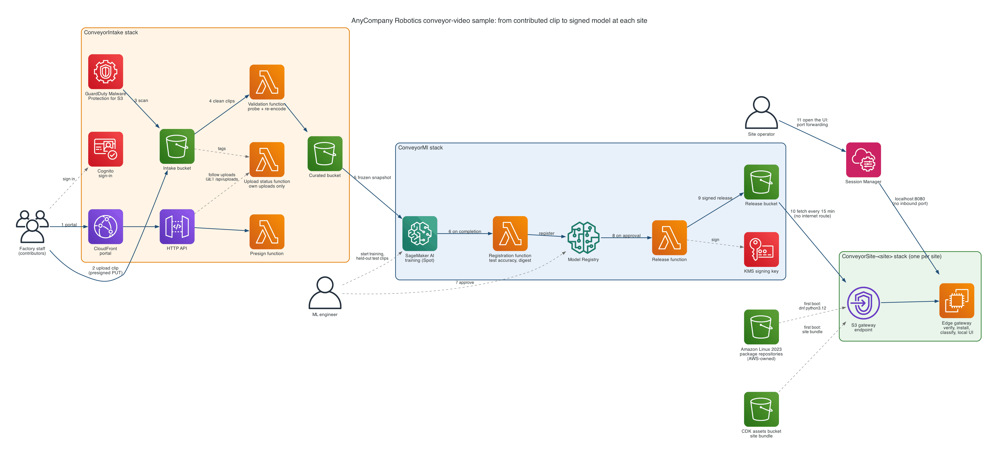
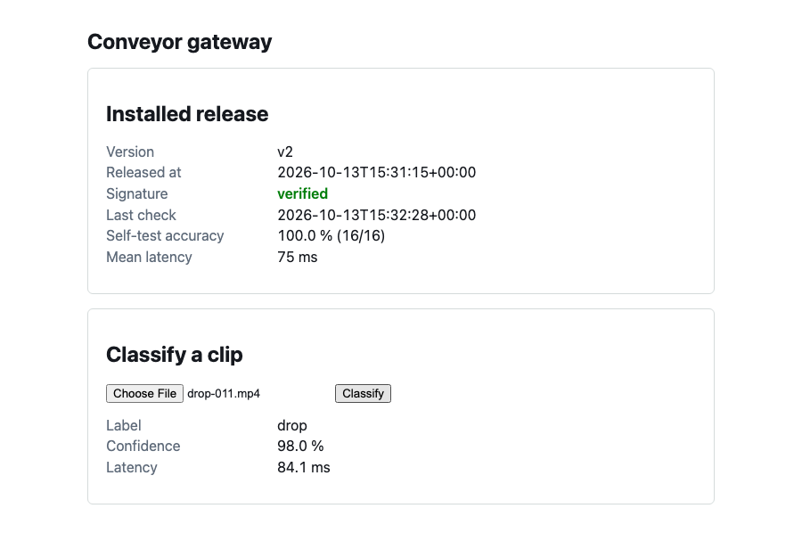

# Video ML from contributed clips to signed edge releases on AWS

**Upload labelled clips, train a model, approve it, and a signed model lands on each
site's edge gateway.**

This sample shows one way to collect labelled video clips from several sites, train
a small video classifier on them, and ship signed model releases to an edge gateway
at each site. The fictitious company AnyCompany Robotics runs conveyor belts at two
sites, `factory-a` and `factory-b`; each clip shows a belt in one of four states:
`normal`, `jam`, `drop` or `empty`.

> **Important:** This is sample code, for non-production usage. You should work with
> your security and legal teams to meet your organizational security, regulatory and
> compliance requirements before deployment. Deploying it creates AWS resources that
> cost money while they exist (see [Cost](#cost)).

## Architecture



Everything deploys into one AWS account and Region as three kinds of AWS CDK stack:
`ConveyorIntake` (portal, intake, malware scan, validation), `ConveyorMl` (dataset
snapshots, training role, model registry with its registration function, signed
releases) and one `ConveyorSite-<site>` per site. The numbered edges follow a clip: a
contributor signs in to the portal and uploads it, GuardDuty scans it, the validation
function re-encodes a clean clip into the curated bucket, a training job runs on a
frozen snapshot of that bucket plus the dataset's held-out test clips, the registration
function registers the model when the job completes, and once an ML engineer approves
it, the release function signs it and each site's gateway fetches, verifies and
installs it.

## How it works

1. **Contribute.** Factory staff sign in to the contributor portal (Amazon
   CloudFront, Amazon Cognito) and upload a clip with a label. The presign
   function signs a PUT to `intake/<site>/<label>/<uuid>.mp4`: the site comes from
   the contributor's Cognito group, the label from an allowlist, and the declared
   size and the tag `contributor=<Cognito sub>` are part of the signature. The
   portal follows each of the contributor's uploads through Upload, Scan, Validate
   and Accept with a read-only status route that answers only for clips carrying
   the caller's own tag. Clip names stay in the browser.
2. **Scan.** Amazon GuardDuty Malware Protection for S3 scans every intake object
   and tags it. The intake bucket policy denies reads of any object not tagged
   `NO_THREATS_FOUND`, to everyone but the scanner.
3. **Validate.** On a clean scan result, an AWS Lambda function probes the clip
   with OpenCV (codec allowlist, every frame decodes, size limits), re-encodes it
   so no container metadata or extra streams survive, and writes it to
   `curated/<site>/<label>/<uuid>.mp4` with a SHA-256 checksum. Rejects leave a
   `rejected/<site>/<label>/<uuid>.json` record with the reason.
4. **Train.** `scripts/train_job.py` freezes the curated set in a snapshot manifest
   (keys, version ids, checksums) and adds the local dataset's test split (320 clips,
   40 per site and label), which contributors never upload, to the snapshot; S3
   checks each test clip against the SHA-256 in the dataset manifest. It then starts
   an Amazon SageMaker AI training job on managed Spot capacity (spare compute at a
   lower price; an interrupted job restarts) that verifies every clip against the
   snapshot, trains tiny3d (a small 3D CNN trained from scratch, so no pretrained
   weights are downloaded) on a train/validation split of the curated clips, keeps
   the epoch with the best validation accuracy and exports ONNX. It scores the
   exported model once on the test clips, which took no part in training or in
   choosing the epoch, and ships two of them per site and label (16) for the
   gateway's self-test.
5. **Register.** When the job completes, Amazon EventBridge invokes the
   registration function, which pins the artefact's object version and SHA-256 and
   registers it in the SageMaker Model Registry as `PendingManualApproval`. The
   registered score, `test_accuracy`, is the exported model's accuracy on the test
   clips; `selection_val_accuracy`, the validation accuracy the epoch was chosen on,
   is kept beside it and overstates the model. Registration does not depend on the
   machine that started the job.
6. **Approve and release.** A person approves the model package. Amazon
   EventBridge invokes the release function, which copies the artefact to the
   release bucket, writes `release.json` (version and SHA-256 of the artefact),
   signs it with an AWS KMS ECC P-256 key and points each site's channel, the small
   file `channels/<site>.json` that names the release a site should run, at the new
   version.
7. **Install at the site.** Each site gateway (an Amazon EC2 instance in a VPC with
   no internet route, no inbound rule and no public address) checks its channel
   every 15 minutes and verifies a new release's signature and digest against the
   public key it pinned at first boot. It then self-tests the release as the
   unprivileged `conveyor` user on the 16 test clips the release ships, and switches
   to it only if the self-test scores at least 90 %; otherwise the running model stays, the UI shows
   the release as refused, and the next run retries. The fetch service runs as root
   inside a systemd sandbox (read-only system, private `/tmp`, no home directories,
   writes only under `/opt/conveyor`). A local web UI on `127.0.0.1:8080` shows the
   installed version, the signature check, any refused release, the self-test score
   and the time of the next check. It classifies an uploaded clip of up to 50 MB,
   after the same video checks the cloud validation runs, and shows its first frame
   and the score of every label. Operators reach it through AWS Systems Manager
   Session Manager port forwarding.

## Repository layout

| Path | Contents |
|---|---|
| `infra/` | AWS CDK (TypeScript) app: `ConveyorIntake`, `ConveyorMl`, one `ConveyorSite-<site>` per site |
| `lambdas/presign/` | Presigned upload URLs |
| `lambdas/status/` | Read-only status of a contributor's own uploads |
| `lambdas/validate/` | OpenCV probe and metadata-stripping re-encode |
| `lambdas/register/` | Model registration when a training job completes |
| `lambdas/release/` | Signed release publication on model approval |
| `ml/train/` | SageMaker training entry point, tiny3d model, snapshot verification, test-split scoring |
| `shared/preprocess.py` | Clip decoding shared by training and the gateway; the clip format is defined once here |
| `shared/ui/tokens.css` | Design tokens of both user interfaces, copied into each at build time |
| `site/` | Gateway installer, release fetch and verification, self-test, local UI (Python standard library) |
| `web/` | Contributor portal (static HTML and JavaScript, no third-party code) |
| `scripts/` | Operator scripts and the binary-package fetch step |
| `scripts/ci/` | CI gate: checkov with a reasoned baseline |
| `tests/` | pytest suites; `infra/test/` holds the CDK assertion tests |
| `.github/workflows/` | CI: the tests, CDK synth and the checkov gate, without AWS credentials |
| `docs/` | Architecture diagram (`python docs/architecture.py docs/architecture` redraws it with the packages in `requirements-docs.in` and Graphviz) and gateway screenshot |

## Prerequisites

- An AWS account, preferably one dedicated to the sample, and a Region. The sample is
  deployed and tested in `eu-west-1`. Another Region must offer GuardDuty Malware
  Protection for S3, SageMaker AI training on `ml.g4dn.xlarge`, and the AWS Deep
  Learning Containers (DLC) PyTorch images that SageMaker pulls from registry account
  `763104351884`.
- The AWS CLI v2 with a profile whose Region is set (`aws configure`, or
  `AWS_PROFILE` and `AWS_DEFAULT_REGION`): the CDK app and the scripts deploy to and
  read from that profile's Region.
- The [Session Manager plugin for the AWS CLI](https://docs.aws.amazon.com/systems-manager/latest/userguide/session-manager-working-with-install-plugin.html),
  to open the gateway UI.
- An administrator, that is a principal allowed to create IAM policies and roles, to
  run `scripts/bootstrap.sh` once per account and Region, and again whenever
  `infra/cfn-exec-policy.json`, `infra/cfn-exec-policy-compute.json` or
  `infra/permissions-boundary.json` changes. It creates three IAM policies named
  `ConveyorSample*` and the CDK toolkit stack `CDKToolkit` with its `cdk-hnb659fds-*`
  roles, bucket, repository and parameter.
  **If the account and Region already have a `CDKToolkit` stack, `bootstrap.sh`
  replaces its execution policies, and every CDK app deploying there gets them.** Check
  first; an empty value means the CDK default, AdministratorAccess:

  ```bash
  aws cloudformation describe-stacks --stack-name CDKToolkit \
    --query "Stacks[0].Parameters[?ParameterKey=='CloudFormationExecutionPolicies'].ParameterValue" --output text
  ```

  `bootstrap.sh` prints the previous policies before it replaces them. To restore them
  once you have removed the sample, run
  `(cd infra && npx cdk bootstrap --cloudformation-execution-policies <previous policy ARNs>)`,
  with `arn:aws:iam::aws:policy/AdministratorAccess` for the default.
- For every other step, an IAM principal with `infra/operator-policy.json`. It allows
  deploying and destroying the stacks through the CDK deploy and file-publishing roles,
  creating contributors, training, approving, opening a gateway UI through Session
  Manager port forwarding and `scripts/teardown.sh`. It grants no IAM write: its only
  IAM action passes the training role to SageMaker, and the only roles it can assume
  are those two CDK roles. Its S3 grants on the `conveyor*` buckets hold only when the
  bucket is in the caller's own account (`s3:ResourceAccount`). Run Command on a
  gateway (`ssm:SendCommand`) is not part of it; no step here needs it. What a deployment can then change is set by the execution
  policies (see [Security](#security)). IAM accepts no policy variable in the account
  field of an ARN, so put your account id in first:
  `sed "s/\${aws:PrincipalAccount}/<account id>/g" infra/operator-policy.json`.
- Node.js 22, Python 3.12 and OpenSSL.
- A Spot training quota of at least one `ml.g4dn.xlarge`; new accounts often have 0.
  Check it and, if needed, request one (approval can take a while):

  ```bash
  aws service-quotas get-service-quota --service-code sagemaker --quota-code L-944F78BB \
    --query 'Quota.[QuotaName,Value]' --output text
  aws service-quotas request-service-quota-increase --service-code sagemaker \
    --quota-code L-944F78BB --desired-value 1
  ```

  `scripts/train_job.py` checks the same quota and prints the request command when it
  is 0.
- The dataset, which `scripts/fetch_dataset.py` downloads, checks against the archive
  SHA-256 set in the script and verifies into `data/conveyor`: a `manifest.json`
  whose top-level `files` list gives each clip's `path`, `site`, `split` and `label`,
  and the clips in `<site>/<split>/<label>/*.mp4`. Your own dataset works the same way
  in that layout; pass its archive URL and SHA-256 to the script.

## Deploy

```bash
python -m venv .venv && .venv/bin/pip install -r requirements-dev.txt
bash scripts/fetch_layer_and_wheels.sh          # OpenCV layer and gateway wheels
(cd infra && npm ci)
bash scripts/bootstrap.sh <region>               # administrator, once per account and Region
(cd infra && npx cdk deploy --all --require-approval never)
```

`--require-approval never` skips CDK's interactive prompt about IAM changes. Every role a
deployment creates is named `Conveyor*` and carries the `ConveyorSampleBoundary`
permissions boundary, which caps what it can do (see [Security](#security)).

The sample assumes a trusted administrator and a single approver. Whoever can deploy can
release, and one operator with `infra/operator-policy.json` can upload a training
artefact to `training-output/`, register it as a model package and approve it, and the
release function signs it. A production deployment separates these rights; see
[What a production deployment must add](#security).

## Use

```bash
# 1. Download the dataset from this sample's GitHub release asset (dataset-v1) and
#    verify it into data/conveyor (manifest.json plus <site>/<split>/<label>/*.mp4;
#    train and val are contributed, test is held out). The script refuses an archive
#    whose SHA-256 is not the one it pins. To use your own dataset, pass its archive
#    URL and SHA-256.
.venv/bin/python scripts/fetch_dataset.py

# 2. Create one contributor per site. The script passes a one-time password to
#    Cognito in a private temporary file and prints it once; sign in once at the
#    portal with it to choose a new one.
bash scripts/create_contributor.sh alice factory-a
bash scripts/create_contributor.sh bob factory-b

# 3. Contribute the train and val clips with each contributor's new password
#    (or upload single clips in the portal).
PORTAL_PASSWORD=... .venv/bin/python scripts/upload_clips.py data/conveyor alice
PORTAL_PASSWORD=... .venv/bin/python scripts/upload_clips.py data/conveyor bob

# 4. Train on a snapshot of the curated clips and the test split of data/conveyor
#    (or the dataset directory passed as an argument). The script stops first if the
#    account's Spot quota for ml.g4dn.xlarge training is 0, then follows the job; the
#    registration function registers the model when the job completes, even if the
#    script was stopped.
.venv/bin/python scripts/train_job.py

# 5. Find the newest model package and its test accuracy, then approve it; the
#    release reaches every site within 15 minutes.
aws sagemaker list-model-packages --model-package-group-name conveyor-events \
  --sort-by CreationTime --sort-order Descending \
  --query 'ModelPackageSummaryList[].[ModelPackageArn,ModelApprovalStatus]' --output text
aws sagemaker describe-model-package --model-package-name <arn> \
  --query 'CustomerMetadataProperties.[test_accuracy,num_test,selection_val_accuracy]' --output text
aws sagemaker update-model-package --model-package-arn <arn> \
  --model-approval-status Approved

# 6. Open a site gateway's UI at http://localhost:8080 with the command in the
#    stack's OpenUi output, and classify a clip from data/conveyor/<site>/test/.
aws cloudformation describe-stacks --stack-name ConveyorSite-factory-a \
  --query "Stacks[0].Outputs[?OutputKey=='OpenUi'].OutputValue" --output text
```

The portal URL is the `PortalUrl` output of the `ConveyorIntake` stack:

```bash
aws cloudformation describe-stacks --stack-name ConveyorIntake \
  --query "Stacks[0].Outputs[?OutputKey=='PortalUrl'].OutputValue" --output text
```

To approve in the console instead, open SageMaker Studio, choose **Models**, then
**Registered models**, open the `conveyor-events` group, select the version and set its
status to **Approved**.

Keep the local port at 8080: the UI answers only requests addressed to
`localhost:8080` or `127.0.0.1:8080`.



## Cost

All figures are **illustrative** estimates in USD for the default deployment in
`eu-west-1`, for a 730-hour month, before taxes, Free Tier and any discounts. Check
current prices for your Region before you deploy.

**Idle cost: about USD 39 per site per month, USD 83 for the default two sites.** Each
site stack bills whether or not anything is uploaded, and its interface VPC endpoints
are the largest item:

| Item | Quantity | Unit price | Per month |
|---|---|---|---|
| Interface VPC endpoints (SSM, SSM Messages, KMS) | 3 per site, 1 AZ | USD 0.011 per endpoint-hour | 24.09 per site |
| `t4g.small` gateway instance | 1 per site | USD 0.0184 per hour | 13.43 per site |
| gp3 volume | 16 GB per site | USD 0.088 per GB-month | 1.41 per site |
| **Per site** | | | **38.93** |
| Two sites | | | 77.86 |
| Customer managed KMS keys | 5 | USD 1.00 per key-month | 5.00 |
| **Idle total, two sites** | | | **82.86** |

Stopping a gateway instance saves its compute (USD 13.43 per site), so the idle total
with both gateways stopped is about USD 56; the endpoints and volumes bill until the
stacks are destroyed. After a year, automatic rotation of the four bucket
keys adds USD 1 per key per month for each of the first two rotations.

**Illustrative monthly usage** at fictitious volumes of 1,000 contributed clips of
10 MB (10 GB), a validation run of 30 seconds per clip and two training runs adds about
USD 3, for a total of about USD 85:

| Item | Assumption | Unit price | Per month |
|---|---|---|---|
| GuardDuty Malware Protection for S3, data scanned | 10 GB | USD 0.1005 per GB | 1.01 |
| GuardDuty Malware Protection for S3, objects evaluated | 1,000 | USD 0.000241 per object | 0.24 |
| Validation function (2 GB, Arm) | 1,000 x 30 s = 60,000 GB-s | USD 0.0000133334 per GB-s | 0.80 |
| S3 Standard storage | 15 GB on average | USD 0.023 per GB-month | 0.35 |
| SageMaker training on `ml.g4dn.xlarge` | 2 runs x 388 billable s | USD 0.822 per hour | 0.18 |
| **Usage total** | | | **2.58** |

**One training run** of tiny3d from scratch on a snapshot of 1,606 clips (30 epochs),
`tiny3d-20261031-092002`, ran for 691 seconds, of which managed Spot billed 388: about
USD 0.09. Managed Spot bills at the on-demand rate for fewer seconds, so the Spot saving
is already in the 388. CloudFront, API Gateway, Cognito, EventBridge,
KMS requests, CloudWatch Logs and VPC endpoint data processing are not itemised; at
these volumes they add little.

**How long it takes:** the first `cdk deploy --all` creates the four stacks one after
another in about 17 minutes and uploads about 160 MB of assets before compression: the
OpenCV layer (102 MB) and the gateway bundle with its wheels (59 MB). A new gateway
installs its code and, when a release already exists, has it verified and installed
about 30 seconds after the instance is created. After that it checks its channel every
15 minutes, so an approved release reaches every site within 15 minutes. A training job takes about 12 minutes of
training time plus the time SageMaker needs to obtain Spot capacity and start the
container.

Unit prices come from the AWS Price List API for `eu-west-1`, retrieved on
2026-10-13; the effective date of each price is: EC2 instance, gp3 volume, Lambda,
S3 and SageMaker 2026-10-01; VPC endpoints and GuardDuty 2026-09-01; KMS 2025-07-01.
The same prices are published on the pricing pages for
[AWS PrivateLink](https://aws.amazon.com/privatelink/pricing/),
[Amazon EC2](https://aws.amazon.com/ec2/pricing/on-demand/),
[Amazon EBS](https://aws.amazon.com/ebs/pricing/),
[AWS KMS](https://aws.amazon.com/kms/pricing/),
[Amazon GuardDuty](https://aws.amazon.com/guardduty/pricing/),
[AWS Lambda](https://aws.amazon.com/lambda/pricing/),
[Amazon S3](https://aws.amazon.com/s3/pricing/) and
[Amazon SageMaker AI](https://aws.amazon.com/sagemaker-ai/pricing/).

## Clean up

```bash
bash scripts/teardown.sh <region>
```

The script deletes the model packages first (CloudFormation cannot delete a model
package group that still holds packages), runs `cdk destroy --all`, deletes the log
groups that Lambda creates at run time for CDK's helper functions, and lists what stays.
Every bucket and every log group the stacks declare is deleted with its stack.
What remains:

- **KMS keys.** The five keys (four bucket keys and the release signing key) are
  scheduled for deletion with the default 30-day waiting period, during which
  `aws kms cancel-key-deletion` can restore them.
- **GuardDuty.** The malware protection plan belongs to `ConveyorIntake` and is
  deleted with it. The sample does not enable a GuardDuty detector, so no other
  GuardDuty plan needs to be turned off. GuardDuty may have created the
  service-linked role for malware protection; keep it if other plans use it.
- **Training logs.** The `tiny3d-` streams in `/aws/sagemaker/TrainingJobs`, a log
  group other training jobs may share:

```bash
for stream in $(aws logs describe-log-streams --log-group-name /aws/sagemaker/TrainingJobs \
    --log-stream-name-prefix tiny3d- --query 'logStreams[].logStreamName' --output text); do
  aws logs delete-log-stream --log-group-name /aws/sagemaker/TrainingJobs --log-stream-name "$stream"
done
```

- **SageMaker training job records** stay in the job history; they cannot be deleted
  and cost nothing.
- **Bootstrap resources.** `scripts/bootstrap.sh` created the `CDKToolkit` stack and the
  IAM policies `ConveyorSampleCfnExec`, `ConveyorSampleCfnExecCompute` and
  `ConveyorSampleBoundary`; removing them takes an administrator, as the operator
  policy cannot. If no other CDK app
  uses this account and Region, delete the stack, then empty and delete its retained
  staging bucket (`cdk-hnb659fds-assets-<account>-<region>`, versioned: use **Empty** in
  the S3 console), then delete the three policies:

```bash
aws cloudformation delete-stack --stack-name CDKToolkit
aws cloudformation wait stack-delete-complete --stack-name CDKToolkit
ACCOUNT=$(aws sts get-caller-identity --query Account --output text)
for name in ConveyorSampleCfnExec ConveyorSampleCfnExecCompute ConveyorSampleBoundary; do
  arn="arn:aws:iam::$ACCOUNT:policy/$name"
  for v in $(aws iam list-policy-versions --policy-arn "$arn" \
      --query 'Versions[?!IsDefaultVersion].VersionId' --output text); do
    aws iam delete-policy-version --policy-arn "$arn" --version-id "$v"
  done
  aws iam delete-policy --policy-arn "$arn"
done
```

To list anything tagged by the sample that is still there (keys pending deletion
included):

```bash
aws resourcegroupstaggingapi get-resources --tag-filters Key=project,Values=sample-video-ml-to-edge \
  --query 'ResourceTagMappingList[].ResourceARN' --output text
```

## Security

Security is a [shared responsibility](https://aws.amazon.com/compliance/shared-responsibility-model/)
between AWS and you. AWS secures the infrastructure that runs the services this sample
uses; you are responsible for how you configure and operate them, for the IAM
principals in your account, for your data, and for the review, testing and hardening a
production deployment needs.

**What the sample enforces**

- Contributors cannot sign up; an administrator creates each one in exactly one site
  group. The API needs a Cognito ID token, the site of an upload comes from that
  group and its label from an allowlist.
- An upload is a presigned PUT for one random key, valid 15 minutes, with its size and
  content type signed.
- Untrusted bytes are read only after a clean malware scan, decoded only inside the
  validation function, and never copied: the curated set holds re-encoded pixels.
- Each bucket is private, versioned and TLS-only; each data bucket has its own KMS
  key, and the portal's static site bucket uses S3-managed encryption. Roles get
  only the prefixes they need. The training role cannot delete or overwrite inputs.
- Training runs on a frozen snapshot whose object versions and checksums the job
  verifies. Its test clips come from the operator's verified copy of the dataset, not
  from contributors, and are the only clips in a release that the validation
  function did not re-encode. The registration function registers only completed
  `tiny3d-` jobs run by the sample's training role, refuses an artefact changed after
  the job ended, and may create a package only as `PendingManualApproval`. A model is
  released only after a person approves it, and only the artefact version and digest
  recorded at registration are signed.
- Releases are signed by a KMS key whose private half never leaves KMS. A gateway
  installs only a release whose `release.json` signature verifies under its pinned
  public key, whose artefact (model, labels and the decoder it runs) matches the
  signed digest, and whose version is higher than the installed one.
- The gateway runs in a VPC with no internet route and accepts no inbound connection.
  Its only egress is HTTPS to the VPC endpoints. Through the S3 endpoint the VPC can
  read only that site's channel file, every signed release, its site bundle and the
  Amazon Linux 2023 package repositories, from which the gateway installs Python 3.12
  at first boot. Its UI listens on the loopback interface only,
  refuses requests whose `Host` is not the forwarded address, and decodes only bodies
  sent as `video/mp4`. Its instance role lets the Systems Manager agent register and
  open Session Manager and Run Command channels, and read no parameter.
- The portal's status route (`GET /api/uploads`) takes no parameters. It lists the
  caller's site only and returns only uploads whose intake object carries the caller's
  Cognito user id in a `contributor` tag, which the presign function signs into every
  upload URL. It reads intake tags and rejection records, and finds accepted clips by
  listing, so it never reads intake or curated clip bytes.
- Each presigned URL is logged with the contributor's Cognito user id, site, label and
  clip id. Gateway, validation-layer and training packages install only when their
  hashes match the committed requirement files. The training job installs
  `ml/train/requirements.txt`, hashed for Linux x86_64 Python 3.12 and regenerated from
  `ml/train/requirements.in` with the `uv pip compile` command in its header; torch and
  the base packages come from the SageMaker PyTorch training image 2.9.0, and its
  opencv, onnx and onnxruntime versions match the CI test lock. The job still downloads
  from PyPI.
- Deployments run with a least-privilege CloudFormation execution role.
  `scripts/bootstrap.sh`, which an administrator runs, replaces the CDK default
  (AdministratorAccess) with two policies, `ConveyorSampleCfnExec`
  (`infra/cfn-exec-policy.json`) and `ConveyorSampleCfnExecCompute`
  (`infra/cfn-exec-policy-compute.json`), split because one would exceed
  the managed policy size limit. Neither grants a service-wide action: they list the
  actions the stacks' resource types need, on the sample's resources
  (`conveyor*` buckets; `Conveyor*` functions, log groups, event rules and roles; the
  `conveyor-events` model package group; for KMS key administration and for stopping
  or deleting EC2 resources, resources tagged `project=sample-video-ml-to-edge`), with
  `*` only for actions that have no resource-level permission. A deployment creates or
  changes only IAM roles named `Conveyor*` that carry the `ConveyorSampleBoundary`
  permissions boundary (`infra/permissions-boundary.json`). The boundary lists the
  actions the sample's roles use, on the sample's resources, and grants no IAM action,
  so no role the app creates can grant itself more. Anyone who can run the deploy can
  still create and change EC2 resources, CloudFront distributions, Cognito user pools,
  API Gateway APIs and the GuardDuty malware protection plan anywhere in the account,
  as those grants are scoped to the account rather than to names or tags; deploy into
  an account dedicated to the sample.
- During a deployment CloudTrail logs a few AccessDenied calls by the CDK execution
  role that the deployment does not need and its CloudFormation handlers tolerate:
  `ssm:ListAssociations`, `servicequotas:GetServiceQuota` and, in an account with a
  CloudFormation Hook, the Hook's reads of the CDK assets bucket's configuration. They
  are harmless.
- Whoever can deploy can also release. A deployment may change the release
  function's code, its role and the signing key's policy, so the right to deploy is
  the right to sign a release. That code changes only through CloudFormation: the CDK
  deploy role has no Lambda permission, and the execution role trusts only
  CloudFormation. The boundary allows `kms:Sign` only to the role CloudFormation names
  `ConveyorMl-PublishFnServiceRole*`, the release function's.

**What a production deployment must add**

- MFA and threat protection for contributors; AWS WAF with rate-based rules and a
  per-contributor quota in front of the API; a custom domain with a TLS 1.2 policy.
- Request validation at the API: the HTTP API has no request validator, and the
  functions validate their own input.
- CloudFront, API Gateway and S3 access logs or CloudTrail S3 data events, kept
  longer than the 30 days of the sample's function logs.
- Log levels and a review of the function logs for secrets; each function writes one
  audit record per event.
- A dead-letter queue or failure destination for the validation, registration and
  release functions, which EventBridge invokes, and a time budget per clip for validation. A
  clip that times out validation (5 minutes at 2 GB) can trigger up to three
  invocations, the first and Lambda's two asynchronous retries, and then stays
  "validating" in the portal.
- A second approver, a staged rollout to one site before the others, signed channel
  documents, and the right to deploy held apart from the right to approve, as
  deploying includes releasing; no write to `training-output/` for whoever approves.
- A release bucket policy that denies writes to `releases/` and `channels/` to every
  principal but the release function's role, and `iam:PassedToService` conditions on
  the `iam:PassRole` grants of the CloudFormation execution policy.
- Training in a VPC without internet access, installing its hash-locked requirements
  from a private mirror such as AWS CodeArtifact.
- Policies on the SSM and KMS interface endpoints, Session Manager restricted to port
  forwarding with session logging, and a KMS key policy that separates key
  administration from signing.
- Site endpoints and gateways across two Availability Zones (the sample uses one per
  site), and gateway credentials of their own (for example IAM Roles Anywhere or AWS
  IoT Greengrass) on physical hardware.
- Operating-system patching of the gateways, for example Systems Manager Patch Manager
  or a patched AMI pipeline; the sample installs packages at first boot only.
- A privacy review, consent and redaction before recording real footage, in particular
  of people.
- A retention review for contributor identity: each upload's `contributor` tag holds the
  contributor's Cognito sub until the intake bucket expires the object after seven days,
  and the presign function's log records the sub and username for one month.

See [CONTRIBUTING](CONTRIBUTING.md#security-issue-notifications) to report a security
issue.

## Known limitations

- The gateway is simulated by an EC2 instance; a physical gateway would replace
  the instance role with its own credentials (for example AWS IoT Greengrass or
  IAM Roles Anywhere).
- Every approved model is released to every site at once; there is no staged
  rollout. Gateways refuse a lower version than the one installed, so a rollback is
  a new, higher release of the older model.
- Each site VPC uses a single Availability Zone, so its endpoints and gateway stop
  while that zone is unavailable.
- Server access logging, AWS WAF and a custom domain with TLS 1.2 are left out to
  keep the sample small; `scripts/ci/checkov-baseline.json` lists each with its reason.
- The SageMaker PyTorch images come from the Deep Learning Containers registry
  account `763104351884`, which serves most Regions; a few opt-in Regions use a
  different account.

## Checks

`.github/workflows/ci.yml` runs these checks on every push and pull request.

```bash
.venv/bin/python -m pytest -q --ignore=tests/train   # what the python-tests CI job runs, on Linux
.venv/bin/pip install -r requirements-train.txt && .venv/bin/python -m pytest -q tests/train
(cd infra && npx tsc --noEmit -p . && npx jest && npx cdk synth -q -o cdk.out)
.venv/bin/python scripts/ci/checkov_gate.py infra/cdk.out
```

## License

This library is licensed under the MIT-0 License. See the [LICENSE](LICENSE) file.
The synthetic dataset (release asset `dataset-v1`) is licensed separately, under the
[Creative Commons Attribution 4.0 International License (CC-BY-4.0)](https://creativecommons.org/licenses/by/4.0/);
the licence text ships inside the archive. Credit it as "Conveyor dataset © Amazon.com, Inc.
or its affiliates, CC-BY-4.0".
The third-party packages it downloads and bundles, and their licences, are listed in
[THIRD-PARTY-LICENSES.md](THIRD-PARTY-LICENSES.md).
